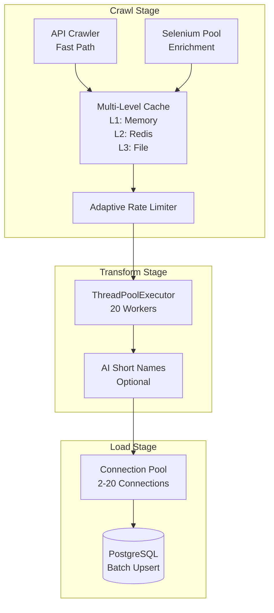
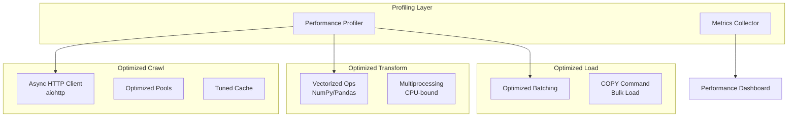

# Design Document: Performance Optimization

## Overview

This design outlines a comprehensive performance optimization strategy for the Tiki data pipeline, a local ETL system that has already achieved significant performance gains (22x speedup). The optimization focuses on identifying and eliminating remaining bottlenecks across seven key dimensions: CPU utilization, I/O operations, memory management, database operations, crawler/API speed, pipeline workflow, and monitoring infrastructure.

The approach is data-driven, beginning with systematic profiling to identify bottlenecks, followed by targeted optimizations in order of impact. The design maintains the existing architecture while introducing performance enhancements that preserve data quality standards (70% completeness threshold).

**Key Design Principles:**
- **Measure First, Optimize Second**: All optimizations are guided by profiling data
- **Incremental Improvement**: Changes are applied incrementally with validation at each step
- **Quality Preservation**: Performance gains must not compromise data completeness or accuracy
- **Local-First**: Optimizations are tailored for local machine execution without cloud dependencies

## Architecture

### Current System Architecture



### Optimization Architecture

The optimization strategy introduces three new architectural components:

1. **Profiling Layer**: Wraps existing components to collect performance metrics
2. **Async I/O Layer**: Replaces synchronous HTTP calls with async operations
3. **Metrics Dashboard**: Aggregates and visualizes performance data



## Components and Interfaces

### 1. Profiling System

**Purpose**: Collect detailed performance metrics to identify bottlenecks

**Components**:

**1.1 Function-Level Profiler**
```python
class FunctionProfiler:
    """Wraps functions to measure execution time and call counts"""
    
    def profile(func: Callable) -> Callable:
        """Decorator that profiles function execution
        
        Collects:
        - Execution time (min, max, mean, p50, p95, p99)
        - Call count
        - Arguments (sampled)
        - Return values (sampled)
        """
        pass
    
    def get_stats() -> Dict[str, ProfileStats]:
        """Returns aggregated statistics for all profiled functions"""
        pass
```

**1.2 Component-Level Profiler**
```python
class ComponentProfiler:
    """Profiles major pipeline components (Crawler, Transformer, Loader)"""
    
    def start_component(component_name: str) -> None:
        """Marks the start of a component execution"""
        pass
    
    def end_component(component_name: str) -> ComponentStats:
        """Marks the end and returns statistics
        
        Collects:
        - Total execution time
        - CPU time
        - I/O wait time
        - Memory usage (peak, average)
        - Items processed
        """
        pass
```

**1.3 Resource Monitor**
```python
class ResourceMonitor:
    """Monitors system resource utilization"""
    
    def sample_resources() -> ResourceSnapshot:
        """Captures current resource usage
        
        Collects:
        - CPU utilization per core
        - Memory usage (RSS, VMS)
        - Disk I/O (read/write bytes)
        - Network I/O (sent/received bytes)
        - Connection pool stats (active, idle)
        """
        pass
    
    def start_monitoring(interval_seconds: float = 1.0) -> None:
        """Starts background resource monitoring"""
        pass
```

**1.4 Bottleneck Analyzer**
```python
class BottleneckAnalyzer:
    """Analyzes profiling data to identify bottlenecks"""
    
    def analyze(profile_data: ProfileData) -> List[Bottleneck]:
        """Identifies and ranks bottlenecks
        
        Returns bottlenecks sorted by impact:
        - HIGH: >20% of total execution time
        - MEDIUM: 5-20% of total execution time
        - LOW: <5% of total execution time
        
        Categorizes by type:
        - CPU: High CPU time, low I/O wait
        - I/O: High I/O wait, low CPU time
        - Memory: High memory allocation/deallocation
        - Database: High DB query time
        - Network: High network wait time
        """
        pass
```

### 2. Async I/O Layer

**Purpose**: Replace synchronous HTTP requests with async operations for better concurrency

**Current Implementation**: Uses `requests` library (synchronous, blocking)

**Optimized Implementation**: Uses `aiohttp` (asynchronous, non-blocking)

**2.1 Async HTTP Client**
```python
class AsyncHTTPClient:
    """Async HTTP client with connection pooling and rate limiting"""
    
    def __init__(
        self,
        connector_limit: int = 300,
        timeout: aiohttp.ClientTimeout = aiohttp.ClientTimeout(total=15, connect=10),
        rate_limiter: AdaptiveRateLimiter = None
    ):
        """Initialize async client with connection pooling
        
        Args:
            connector_limit: Max concurrent connections
            timeout: Request timeout configuration
            rate_limiter: Optional rate limiter for request throttling
        """
        self.session = aiohttp.ClientSession(
            connector=aiohttp.TCPConnector(limit=connector_limit),
            timeout=timeout
        )
        self.rate_limiter = rate_limiter
    
    async def get(self, url: str, **kwargs) -> aiohttp.ClientResponse:
        """Async GET request with rate limiting"""
        if self.rate_limiter:
            await self.rate_limiter.acquire()
        return await self.session.get(url, **kwargs)
    
    async def get_many(self, urls: List[str]) -> List[Dict]:
        """Fetch multiple URLs concurrently
        
        Returns results in same order as input URLs
        Handles errors gracefully (returns None for failed requests)
        """
        tasks = [self.get(url) for url in urls]
        return await asyncio.gather(*tasks, return_exceptions=True)
    
    async def close(self) -> None:
        """Close session and cleanup connections"""
        await self.session.close()
```

**2.2 Async Crawler Adapter**
```python
class AsyncCrawlerAdapter:
    """Adapts existing crawler to use async I/O"""
    
    async def crawl_products_async(
        self,
        product_ids: List[str],
        batch_size: int = 50
    ) -> AsyncIterator[Product]:
        """Crawl products using async I/O
        
        Yields products as they are fetched (streaming)
        Processes batches concurrently
        """
        for batch in chunk_list(product_ids, batch_size):
            urls = [self._build_url(pid) for pid in batch]
            responses = await self.client.get_many(urls)
            
            for response in responses:
                if response and not isinstance(response, Exception):
                    yield self._parse_response(response)
```

**Why aiohttp over httpx**: Based on research, aiohttp is better suited for high-concurrency scenarios like web scraping. It has been battle-tested for over a decade and handles thousands of concurrent connections efficiently. While httpx has a more modern API, aiohttp's performance characteristics align better with the pipeline's needs ([source](https://miguel-mendez-ai.com/2024/10/20/aiohttp-vs-httpx)).

### 3. CPU Optimization Components

**Purpose**: Reduce CPU bottlenecks through vectorization and multiprocessing

**3.1 Vectorized Transformer**
```python
class VectorizedTransformer:
    """Uses NumPy/Pandas for batch transformations"""
    
    def transform_batch(self, products: List[Dict]) -> pd.DataFrame:
        """Transform product batch using vectorized operations
        
        Replaces loops with:
        - Pandas DataFrame operations for data manipulation
        - NumPy arrays for numerical computations
        - Vectorized string operations for text processing
        """
        df = pd.DataFrame(products)
        
        # Vectorized operations instead of loops
        df['price_normalized'] = df['price'] / 1000  # NumPy array operation
        df['name_clean'] = df['name'].str.strip().str.lower()  # Vectorized string ops
        df['discount_pct'] = (df['original_price'] - df['price']) / df['original_price'] * 100
        
        return df
```

**3.2 Multiprocessing Pool**
```python
class MultiprocessingTransformer:
    """Uses multiprocessing for CPU-bound transformations"""
    
    def __init__(self, num_processes: int = None):
        """Initialize multiprocessing pool
        
        Args:
            num_processes: Number of worker processes (defaults to CPU count)
        """
        self.num_processes = num_processes or multiprocessing.cpu_count()
        self.pool = multiprocessing.Pool(processes=self.num_processes)
    
    def transform_parallel(
        self,
        products: List[Dict],
        transform_func: Callable
    ) -> List[Dict]:
        """Apply transformation function in parallel across processes
        
        Bypasses GIL for true parallelism on CPU-bound tasks
        Uses chunking to minimize inter-process communication overhead
        """
        chunk_size = max(1, len(products) // (self.num_processes * 4))
        return self.pool.map(transform_func, products, chunksize=chunk_size)
```

**When to use Threading vs Multiprocessing**:
- **Threading (current)**: Good for I/O-bound tasks (network requests, file I/O)
- **Multiprocessing (new)**: Required for CPU-bound tasks to bypass GIL ([source](https://www.safjan.com/threading-vs-multiprocessing-gil-implications/))

The pipeline should use threading for I/O operations and multiprocessing for CPU-intensive transformations.

### 4. Memory Optimization Components

**Purpose**: Reduce memory footprint and eliminate unnecessary data copying

**4.1 Streaming Iterator**
```python
class StreamingIterator:
    """Processes data in chunks without loading everything into memory"""
    
    def stream_products(
        self,
        source: Iterable[Product],
        chunk_size: int = 1000
    ) -> Iterator[List[Product]]:
        """Yields chunks of products for processing
        
        Advantages:
        - Constant memory usage regardless of dataset size
        - Enables pipeline parallelism (crawl while transforming)
        - Reduces GC pressure
        """
        chunk = []
        for product in source:
            chunk.append(product)
            if len(chunk) >= chunk_size:
                yield chunk
                chunk = []
        
        if chunk:
            yield chunk
```

**4.2 Object Pool**
```python
class ObjectPool:
    """Reuses objects to reduce allocation overhead"""
    
    def __init__(self, factory: Callable, max_size: int = 100):
        """Initialize object pool
        
        Args:
            factory: Function that creates new objects
            max_size: Maximum number of pooled objects
        """
        self.factory = factory
        self.max_size = max_size
        self.pool: Deque = deque()
        self.lock = threading.Lock()
    
    def acquire(self) -> Any:
        """Get object from pool or create new one"""
        with self.lock:
            if self.pool:
                return self.pool.popleft()
        return self.factory()
    
    def release(self, obj: Any) -> None:
        """Return object to pool for reuse"""
        with self.lock:
            if len(self.pool) < self.max_size:
                self.pool.append(obj)
```

**4.3 In-Memory Cache Tuning**
```python
class TunedLRUCache:
    """LRU cache with configurable size and eviction policy"""
    
    def __init__(
        self,
        max_size_mb: int = 100,
        eviction_threshold: float = 0.9
    ):
        """Initialize cache with memory limits
        
        Args:
            max_size_mb: Maximum cache size in megabytes
            eviction_threshold: Trigger eviction at this % of max_size
        """
        self.max_size_bytes = max_size_mb * 1024 * 1024
        self.eviction_threshold = eviction_threshold
        self.cache: OrderedDict = OrderedDict()
        self.current_size = 0
    
    def get(self, key: str) -> Optional[Any]:
        """Get value and move to end (most recently used)"""
        if key in self.cache:
            self.cache.move_to_end(key)
            return self.cache[key]
        return None
    
    def put(self, key: str, value: Any) -> None:
        """Add value and evict if necessary"""
        value_size = sys.getsizeof(value)
        
        # Evict if over threshold
        while self.current_size + value_size > self.max_size_bytes * self.eviction_threshold:
            evicted_key, evicted_value = self.cache.popitem(last=False)
            self.current_size -= sys.getsizeof(evicted_value)
        
        self.cache[key] = value
        self.current_size += value_size
```

### 5. Database Optimization Components

**Purpose**: Maximize database throughput through batching and connection tuning

**5.1 Optimized Batch Loader**
```python
class OptimizedBatchLoader:
    """Loads data using optimized batch operations"""
    
    def __init__(
        self,
        connection_pool: ConnectionPool,
        batch_size: int = 1000
    ):
        """Initialize loader with connection pool
        
        Args:
            connection_pool: PostgreSQL connection pool
            batch_size: Number of records per batch (tuned based on profiling)
        """
        self.pool = connection_pool
        self.batch_size = batch_size
    
    def upsert_batch(self, products: List[Product]) -> int:
        """Upsert products using batch operation
        
        Uses PostgreSQL's INSERT ... ON CONFLICT for efficient upserts
        Batches operations to minimize round-trips
        Uses prepared statements to reduce parsing overhead
        
        Returns: Number of rows affected
        """
        with self.pool.get_connection() as conn:
            with conn.cursor() as cur:
                # Use COPY for bulk inserts (fastest method)
                # Falls back to batch INSERT for upserts
                if self._is_insert_only(products):
                    return self._copy_insert(cur, products)
                else:
                    return self._batch_upsert(cur, products)
    
    def _copy_insert(self, cursor, products: List[Product]) -> int:
        """Use COPY command for fastest bulk insert
        
        COPY bypasses much of PostgreSQL's overhead and is the fastest
        method for bulk loading ([source](https://reintech.io/blog/efficient-bulk-data-loading-postgresql))
        """
        # Create temporary CSV in memory
        buffer = io.StringIO()
        writer = csv.writer(buffer)
        for product in products:
            writer.writerow(product.to_tuple())
        
        buffer.seek(0)
        cursor.copy_from(buffer, 'products', sep=',', columns=product.columns())
        return len(products)
    
    def _batch_upsert(self, cursor, products: List[Product]) -> int:
        """Use batch INSERT ... ON CONFLICT for upserts"""
        query = """
            INSERT INTO products (id, name, price, ...)
            VALUES %s
            ON CONFLICT (id) DO UPDATE SET
                name = EXCLUDED.name,
                price = EXCLUDED.price,
                ...
        """
        # Use execute_values for efficient batch insert
        from psycopg2.extras import execute_values
        values = [product.to_tuple() for product in products]
        execute_values(cursor, query, values, page_size=self.batch_size)
        return len(products)
```

**5.2 Connection Pool Tuner**
```python
class ConnectionPoolTuner:
    """Dynamically tunes connection pool size based on workload"""
    
    def recommend_pool_size(
        self,
        avg_query_time_ms: float,
        queries_per_second: float,
        target_utilization: float = 0.8
    ) -> int:
        """Calculate optimal pool size
        
        Formula: pool_size = (queries_per_second * avg_query_time_ms / 1000) / target_utilization
        
        Args:
            avg_query_time_ms: Average query execution time
            queries_per_second: Expected query rate
            target_utilization: Target connection utilization (0.0-1.0)
        
        Returns: Recommended pool size
        """
        required_connections = (queries_per_second * avg_query_time_ms / 1000)
        return max(2, int(required_connections / target_utilization))
```

**Batch Size Tuning**: Research indicates that batch sizes between 500-5000 records provide optimal performance for PostgreSQL bulk operations. The exact optimal size depends on row width and available memory. The design includes profiling to determine the best batch size for this specific workload.

### 6. Configuration Optimizer

**Purpose**: Recommend optimal configuration values based on machine capabilities and profiling data

**6.1 Configuration Analyzer**
```python
class ConfigurationAnalyzer:
    """Analyzes system and recommends optimal configuration"""
    
    def analyze_system(self) -> SystemCapabilities:
        """Detect system capabilities
        
        Returns:
            - CPU cores (physical and logical)
            - Available memory
            - Disk I/O speed (read/write)
            - Network bandwidth
        """
        pass
    
    def recommend_config(
        self,
        system: SystemCapabilities,
        profile_data: ProfileData
    ) -> OptimizedConfig:
        """Generate optimized configuration
        
        Recommendations include:
        - PRODUCT_BATCH_SIZE: Based on memory and processing speed
        - PRODUCT_POOL_SIZE: Based on CPU cores and I/O characteristics
        - HTTP_CONNECTOR_LIMIT: Based on network bandwidth and latency
        - ThreadPool/ProcessPool sizes: Based on workload type (I/O vs CPU)
        - Connection pool sizes: Based on query patterns
        - Cache sizes: Based on available memory and hit rates
        """
        pass
```

## Data Models

### Performance Metrics

**ProfileStats**
```python
@dataclass
class ProfileStats:
    """Statistics for a profiled function"""
    function_name: str
    call_count: int
    total_time_ms: float
    min_time_ms: float
    max_time_ms: float
    mean_time_ms: float
    p50_time_ms: float
    p95_time_ms: float
    p99_time_ms: float
    cpu_time_ms: float
    io_wait_ms: float
```

**ComponentStats**
```python
@dataclass
class ComponentStats:
    """Statistics for a pipeline component"""
    component_name: str
    execution_time_ms: float
    cpu_time_ms: float
    io_wait_ms: float
    memory_peak_mb: float
    memory_avg_mb: float
    items_processed: int
    throughput_items_per_sec: float
```

**ResourceSnapshot**
```python
@dataclass
class ResourceSnapshot:
    """System resource usage at a point in time"""
    timestamp: datetime
    cpu_percent: float
    cpu_per_core: List[float]
    memory_rss_mb: float
    memory_vms_mb: float
    disk_read_mb: float
    disk_write_mb: float
    network_sent_mb: float
    network_recv_mb: float
    connection_pool_active: int
    connection_pool_idle: int
```

**Bottleneck**
```python
@dataclass
class Bottleneck:
    """Identified performance bottleneck"""
    name: str
    category: str  # CPU, I/O, Memory, Database, Network
    severity: str  # HIGH, MEDIUM, LOW
    time_percentage: float
    description: str
    recommendation: str
```

**OptimizedConfig**
```python
@dataclass
class OptimizedConfig:
    """Recommended configuration values"""
    # Crawl configuration
    product_batch_size: int
    product_pool_size: int
    http_connector_limit: int
    http_timeout_total: int
    http_timeout_connect: int
    
    # Transform configuration
    thread_pool_size: int
    process_pool_size: int
    use_vectorization: bool
    
    # Load configuration
    db_connection_pool_min: int
    db_connection_pool_max: int
    db_batch_size: int
    use_copy_command: bool
    
    # Cache configuration
    redis_cache_ttl: int
    memory_cache_size_mb: int
    cache_eviction_threshold: float
    
    # Rationale for each recommendation
    rationale: Dict[str, str]
```

## Error Handling

### Profiling Errors

**Profiler Failures**: If profiling fails, the system should continue execution without profiling rather than crashing. Profiling is observability, not critical functionality.

```python
def safe_profile(func):
    """Decorator that profiles function but continues on profiler errors"""
    @wraps(func)
    def wrapper(*args, **kwargs):
        try:
            return profiler.profile(func)(*args, **kwargs)
        except ProfilerError as e:
            logger.warning(f"Profiling failed for {func.__name__}: {e}")
            return func(*args, **kwargs)
    return wrapper
```

### Async I/O Errors

**Connection Failures**: Async operations should handle connection failures gracefully with exponential backoff retry logic.

```python
async def get_with_retry(
    client: AsyncHTTPClient,
    url: str,
    max_retries: int = 3
) -> Optional[Dict]:
    """Fetch URL with exponential backoff retry"""
    for attempt in range(max_retries):
        try:
            response = await client.get(url)
            return await response.json()
        except (aiohttp.ClientError, asyncio.TimeoutError) as e:
            if attempt == max_retries - 1:
                logger.error(f"Failed to fetch {url} after {max_retries} attempts: {e}")
                return None
            
            wait_time = 2 ** attempt  # Exponential backoff
            await asyncio.sleep(wait_time)
```

**Rate Limiting**: When rate limits are hit, the system should back off and retry rather than failing.

### Memory Errors

**Out of Memory**: If memory pressure is detected, the system should reduce batch sizes dynamically.

```python
class AdaptiveBatchSizer:
    """Dynamically adjusts batch size based on memory pressure"""
    
    def adjust_batch_size(
        self,
        current_batch_size: int,
        memory_usage_percent: float
    ) -> int:
        """Reduce batch size if memory usage is high"""
        if memory_usage_percent > 90:
            return max(10, current_batch_size // 2)
        elif memory_usage_percent > 80:
            return max(10, int(current_batch_size * 0.75))
        elif memory_usage_percent < 60:
            return min(10000, int(current_batch_size * 1.25))
        return current_batch_size
```

### Database Errors

**Connection Pool Exhaustion**: If all connections are in use, wait with timeout rather than failing immediately.

**Deadlocks**: Retry transactions that fail due to deadlocks (PostgreSQL error code 40P01).

**Constraint Violations**: Log and skip records that violate constraints rather than failing the entire batch.

## Testing Strategy

### Unit Testing

Unit tests will focus on:
- Individual component functionality (profiler, async client, transformers)
- Error handling paths
- Configuration validation
- Data model serialization/deserialization

### Property-Based Testing

Property-based tests will verify universal properties across the optimization:
- Data integrity: Optimized code produces identical results to original
- Performance: Optimized code is faster than baseline
- Resource usage: Optimized code uses less memory/CPU
- Correctness: All acceptance criteria are satisfied

Each property test will run a minimum of 100 iterations with randomized inputs to ensure comprehensive coverage.

### Integration Testing

Integration tests will verify:
- End-to-end pipeline execution with optimizations enabled
- Interaction between profiling layer and pipeline components
- Async I/O integration with existing crawler
- Database operations with optimized loader

### Performance Testing

Performance tests will establish:
- Baseline metrics before optimization
- Metrics after each optimization phase
- Comparison reports showing improvement
- Regression detection for future changes

**Benchmark Scenarios**:
1. Small dataset: 100 products
2. Medium dataset: 1,000 products
3. Large dataset: 10,000 products

**Metrics Collected**:
- Total execution time
- Throughput (products/second)
- CPU utilization
- Memory usage (peak and average)
- Database query time
- Network time
- Cache hit rates

### Test Configuration

All property-based tests will:
- Run minimum 100 iterations
- Use the fast-check library for Python (Hypothesis)
- Tag tests with feature name and property number
- Reference the design document property being validated

Example test structure:
```python
from hypothesis import given, strategies as st

@given(st.lists(st.dictionaries(...), min_size=1, max_size=1000))
def test_property_1_data_integrity(products):
    """Feature: performance-optimization, Property 1: Data integrity preservation
    
    For any list of products, the optimized transformer should produce
    identical results to the original transformer.
    """
    original_result = original_transformer.transform(products)
    optimized_result = optimized_transformer.transform(products)
    assert original_result == optimized_result
```


## Correctness Properties

*A property is a characteristic or behavior that should hold true across all valid executions of a system—essentially, a formal statement about what the system should do. Properties serve as the bridge between human-readable specifications and machine-verifiable correctness guarantees.*

### Property 1: Profiling Metrics Completeness

*For any* pipeline execution with profiling enabled, the profiling system should collect execution time metrics for all major components (Crawler, Transformer, Loader), function-level timing data for critical paths, memory allocation patterns, and database operation statistics.

**Validates: Requirements 1.1, 1.4, 1.6, 1.7**

### Property 2: Bottleneck Categorization and Ranking

*For any* set of profiling data, all identified bottlenecks should be categorized into exactly one of the valid types (CPU, I/O, Memory, Database, Network) and ranked by impact (HIGH for >20%, MEDIUM for 5-20%, LOW for <5% of total execution time) in descending order of time percentage.

**Validates: Requirements 1.2, 1.3**

### Property 3: Profiling Report Structure

*For any* completed profiling session, the generated report should contain exactly the top 10 slowest operations sorted by execution time in descending order, with each operation including execution time and call count.

**Validates: Requirements 1.5**

### Property 4: Concurrent Request Limits

*For any* batch of HTTP requests, the number of concurrent connections should never exceed the configured connector limit, and all requests should eventually complete or fail with appropriate error handling.

**Validates: Requirements 3.2**

### Property 5: Configuration Recommendation Validity

*For any* system capabilities and profiling data, all generated configuration recommendations (batch sizes, pool sizes, timeouts, cache TTLs) should be within valid ranges for their respective parameters and include a non-empty rationale explaining the recommendation.

**Validates: Requirements 3.5, 5.2, 5.3, 7.1, 7.7, 9.1, 9.2, 9.3, 9.4, 9.5, 9.6, 9.7**

### Property 6: Streaming Memory Bounds

*For any* dataset size, when using streaming/generator-based processing, the peak memory usage should remain bounded by a constant factor (not grow linearly with dataset size), demonstrating that data is processed in chunks rather than loaded entirely into memory.

**Validates: Requirements 4.1**

### Property 7: LRU Cache Eviction Correctness

*For any* sequence of cache operations that exceeds the cache size limit, the evicted items should always be the least recently used items, and the cache size should never exceed the configured maximum.

**Validates: Requirements 4.3**

### Property 8: Batch Upsert Correctness

*For any* list of products, batch upsert operations should result in all products being present in the database with correct values, regardless of whether they were inserts or updates, and the operation should complete successfully even for large batches.

**Validates: Requirements 5.1**

### Property 9: Connection Pool Bounds

*For any* workload, the connection pool should maintain the number of active connections within the configured minimum and maximum bounds, and should not exhaust available connections when operating within expected load parameters.

**Validates: Requirements 5.5**

### Property 10: Adaptive Rate Limiting

*For any* sequence of requests, the adaptive rate limiter should dynamically adjust request rates based on response times and error rates, staying within configured bounds and backing off when errors increase.

**Validates: Requirements 6.1, 6.4**

### Property 11: Driver Pool Reuse

*For any* sequence of Selenium operations, driver instances should be reused from the pool rather than created fresh for each operation, minimizing driver startup overhead while maintaining correctness.

**Validates: Requirements 6.5**

### Property 12: Data Completeness Preservation

*For any* dataset processed through the optimized pipeline, the data completeness percentage should remain at or above the 70% threshold, matching or exceeding the completeness of the original implementation.

**Validates: Requirements 6.6, 10.1**

### Property 13: Cache Hit Bypass

*For any* request that results in a cache hit, no network request should be initiated, and the cached data should be served directly, reducing network overhead.

**Validates: Requirements 6.7**

### Property 14: Batch Size Memory Safety

*For any* configured batch size, the pipeline should process batches without exceeding available memory limits, and should dynamically reduce batch size if memory pressure is detected.

**Validates: Requirements 7.2**

### Property 15: Performance Metrics Collection

*For any* pipeline run, the system should collect and store all required performance metrics including throughput, latency, error rates, CPU utilization, memory usage, disk I/O, network I/O, and cache hit rates for all cache levels.

**Validates: Requirements 8.1, 8.2, 8.5, 8.6**

### Property 16: Performance Regression Detection

*For any* pipeline run where performance metrics degrade beyond configured thresholds compared to baseline, the system should generate alerts to notify developers of potential regressions.

**Validates: Requirements 8.4**

### Property 17: Comparison Report Completeness

*For any* optimization phase completion, the generated before/after comparison report should include all required metrics (throughput, latency, resource usage) with statistical analysis (mean, median, standard deviation, percentiles) for both baseline and optimized versions.

**Validates: Requirements 8.7, 11.5, 11.7**

### Property 18: Optimization Result Equivalence (Critical)

*For any* input dataset, the optimized implementation should produce identical results to the original implementation, ensuring that performance improvements do not compromise correctness or data integrity.

**Validates: Requirements 10.2, 12.2**

### Property 19: Error Rate Non-Regression

*For any* comparable workload, the error rate of the optimized implementation should not exceed the error rate of the original implementation, ensuring reliability is maintained or improved.

**Validates: Requirements 10.3**

### Property 20: Data Validation Preservation

*For any* invalid input data, the optimized implementation should reject it with appropriate error messages, maintaining all validation logic from the original implementation.

**Validates: Requirements 10.4**

### Property 21: Cache Freshness Enforcement

*For any* cached item, the system should not serve data that has exceeded its configured TTL (time-to-live), ensuring stale data is not returned beyond acceptable freshness windows.

**Validates: Requirements 10.5**

### Property 22: Audit Trail Completeness

*For any* pipeline execution, the system should generate logs for all key operations (data fetching, transformation, loading, errors) to maintain audit trails for debugging and quality assurance.

**Validates: Requirements 10.6**

### Property 23: Quality Metrics in Performance Tests

*For any* performance test execution, the test results should include both performance metrics (throughput, latency) and data quality metrics (completeness, accuracy, error rates) to ensure quality is verified alongside performance.

**Validates: Requirements 10.7**

### Property 24: Baseline Metrics Capture

*For any* optimization project, the system should establish and store baseline performance metrics (throughput, latency, resource usage) before any optimizations are applied, enabling accurate before/after comparisons.

**Validates: Requirements 11.1**

### Property 25: Benchmark Workload Consistency

*For any* before/after performance comparison, the workloads should be identical (same input data, same operations) to ensure fair comparison and accurate measurement of optimization impact.

**Validates: Requirements 11.2**

### Property 26: Benchmark Dataset Coverage

*For any* benchmark suite execution, performance should be measured across all required dataset sizes (small: 100 products, medium: 1,000 products, large: 10,000 products) to identify scaling characteristics.

**Validates: Requirements 11.3**

### Property 27: Benchmark Environmental Recording

*For any* benchmark execution, the system should record environmental conditions (CPU load, available memory, network conditions) to enable analysis of external factors that may affect results.

**Validates: Requirements 11.4**

### Property 28: Benchmark Reproducibility

*For any* benchmark scenario, running the same benchmark multiple times under similar conditions should produce results within an acceptable variance range (e.g., ±10%), demonstrating reproducibility.

**Validates: Requirements 11.6**

### Property 29: Refactored Code Performance Improvement

*For any* critical path that has been refactored, the refactored implementation should demonstrate measurable performance improvement over the original implementation when tested with identical workloads.

**Validates: Requirements 12.1, 12.6**

